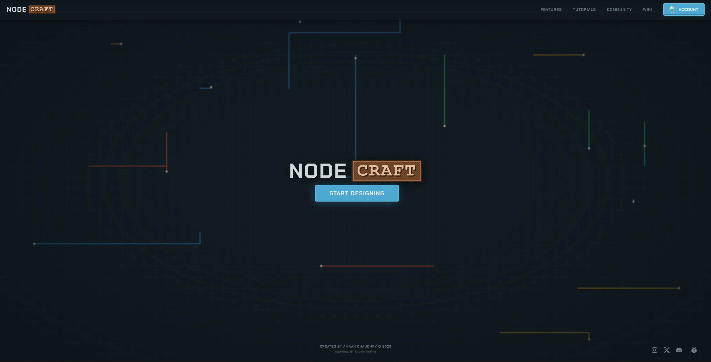
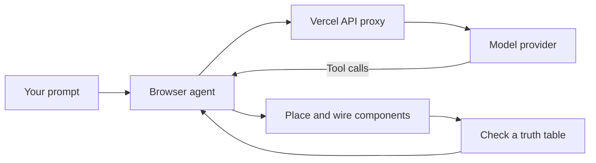

<div align="center">

# NodeCraft

### Build circuits. Watch signals. Understand the logic.

A playful, browser-based workshop for logic circuits — inspired by the Stormworks microcontroller editor.

[](https://nodecraft-plum.vercel.app/)
[](docs/media/nodecraft-demo.mp4)

**[Explore the features](#your-circuit-workshop)** · **[Build your first circuit](#your-first-circuit)** · **[Meet the assistant](#build-with-a-little-help)**



<sub>Actual project screenshot. Open the demo above to see the app in motion.</sub>

</div>

---

## Logic you can play with

Drag a gate onto the canvas, connect its pins, flip a switch, and watch the signal travel. Start with a light that turns on. Work up to an adder. Package your circuit into a reusable block, then use that block to build something bigger.

NodeCraft combines hands-on learning with an industrial, game-like interface: an infinite canvas, a component library, a quick-access bar, and animated wires. **Red wires carry on/off signals. Green wires carry numbers.**

The GitHub repository is named **Circuit-Builder**; the app is called **NodeCraft**.

## Your circuit workshop

<table>
<tr>
<td width="50%" valign="top">

### 🧩 Build from components

49 built-in components covering logic, maths, memory, timing, inputs, and displays. Search the library or hover over a tile for a quick explanation.

</td>
<td width="50%" valign="top">

### ⚡ See what happens

Animated wires and live displays make signals visible. Pause the simulation or advance one tick at a time to explore changing behaviour.

</td>
</tr>
<tr>
<td valign="top">

### 📦 Make your own blocks

Group a selection into a named sub-circuit. Add a description, rename its pins, duplicate it, and nest blocks inside other blocks. Ungroup a block to inspect its gates.

</td>
<td valign="top">

### ✨ Build with AI

Ask the assistant to build, explain, or correct a circuit. Components appear one by one, wires draw onto the board, and the assistant can check combinational behaviour with a truth table.

</td>
</tr>
<tr>
<td valign="top">

### ☁️ Keep your creations

Sign in to save circuits with a name, description, and hand-drawn thumbnail. Browse, search, and load your cloud library across devices.

</td>
<td valign="top">

### 🎮 Stay in the flow

Copy, cut, paste, duplicate, undo, and redo. Navigate with pan, zoom, and a minimap. Settings remember your theme, sensitivities, and snap-to-grid preference.

</td>
</tr>
</table>

## Your first circuit

1. **[Open NodeCraft](https://nodecraft-plum.vercel.app/)** and choose **Start Designing**.
2. Open the **Components** button in the top bar, or press **Tab**.
3. Double-click **Switch**, then click the canvas to place it. Repeat with **Light**.
4. Drag a wire from the Switch's output pin to the Light's input pin.
5. Toggle the Switch. The light responds — you've built your first circuit.

The guided tutorial walks you through placement and wiring. Double-click a node to configure it; hover over pins to learn what they do.

**Next challenge:** place a **NOT** gate between the Switch and Light. Can you make the light turn on when the switch is off?

## Build with a little help

Open the **★ assistant** in the top bar and describe what you want:

> Build a half adder with switches A and B, a Sum light, and a Carry light. Verify it.

> Explain what the circuit on my board does.

> My Sum output is wrong. Fix the half adder and check its truth table.

The assistant reads the circuit, places and wires components, and can test every combination of switch inputs. Its work is visible on the canvas and can be undone as one action.

**No account is required to use the simulator.** The assistant is also open by default when the deployment has an API key configured. Cloud saving requires sign-in. AI availability depends on the configured provider and its usage limits.

## Turn a circuit into a building block

Select two or more components, then **right-click → Group into Block…**. Give the block a name and description, and label its inputs and outputs before creating it.

Right-click an existing block to edit its details or ungroup it. Copy and paste a block to make another instance; each instance keeps its own internal state.

For now, keep Switches and Levers outside the block. Blocks expose a port for each boundary pin, and placing another instance uses copy/paste. A separate saved-block library and custom pin layout are roadmap items.

<details>
<summary><strong>Explore the component library</strong></summary>

| Category | Components |
| :--- | :--- |
| Logic | AND, OR, NOT, XOR, NAND, NOR, XNOR, Buffer, Tri-State, Threshold, Numerical Switchbox |
| Maths | ADD, SUB, MUL, DIV, MOD, POW, SQRT, ABS, NEG, MIN, MAX, CLAMP, ROUND, FLOOR, CEIL, Equal, Greater Than, Less Than |
| Custom formulas | Function gate, such as `x * 2 + 1` |
| Memory | SR Latch, D/JK/T Flip-Flops, Memory Register, Counter, Up/Down Counter |
| Timing and signals | Clock, Timer, Delay, Pulse, Debounce, Random |
| Inputs and displays | Switch, Lever, Constant, Light, Dial, Bar Graph |

The simulator supports Boolean and numerical signals. Multi-bit buses, RAM/ROM, waveform tools, and circuit synthesis are planned; they are not implemented yet. Truth-table sweeps are intended for combinational circuits and do not prove clocked or memory-dependent behaviour.

</details>

<details>
<summary><strong>Handy controls</strong></summary>

| Action | Control |
| :--- | :--- |
| Open / close the component library | Components button or **Tab** |
| Close menus or cancel placement | **Esc** |
| Configure a component | Double-click the node |
| Select several components | **Shift + click** or drag a selection box |
| Copy / cut / paste | **Ctrl / Cmd + C / X / V** |
| Duplicate | **Ctrl / Cmd + D** |
| Group / ungroup | **Ctrl / Cmd + G** / **Ctrl / Cmd + Shift + G** |
| Undo / redo | **Ctrl / Cmd + Z** / **Ctrl / Cmd + Y** |
| Quick-access slots | **1–0** |
| Pan the canvas | Middle mouse or trackpad |
| Zoom | Scroll wheel or pinch |
| Pause / advance the simulation | Top-bar Pause and Step buttons |

</details>

---

## Explore the project

| Looking for… | Start here |
| :--- | :--- |
| A detailed feature tour | [Project description](Description.md) |
| A browser-friendly version of the tour | [Description.html](Description.html) |
| What's changed | [Change catalog](CATALOG.md) |
| What's planned next | [Upgrade roadmap](Upgrade%20Roadmap.md) |
| The feature checklist | [Features and improvements](Features%20and%20Improvments.txt) |
| Source structure and developer notes | [GEMINI.md](GEMINI.md) |

<details>
<summary><strong>For developers — run locally and configure the assistant</strong></summary>

The frontend uses vanilla JavaScript modules, HTML/CSS, and SVG wires. There is no frontend build step. Supabase handles accounts and cloud storage; a Vercel function forwards assistant requests to the configured model provider.

With Node.js installed, run from the repository root:

```bash
node tools/dev-server.mjs
```

Open `http://localhost:4321`. The simulator works without an AI key; the assistant needs one. VS Code Live Server serves the frontend but does not run `/api/agent`.

Create a git-ignored `.env.local` file to enable the assistant:

```dotenv
AGENT_API_KEY=your-provider-key
AGENT_PROVIDER=gemini
AGENT_MODEL=gemini-flash-latest
# Optional: require a Supabase session before using the assistant.
# AGENT_REQUIRE_AUTH=1
```

Supported adapters: **Gemini**, **OpenRouter**, and **Grok**. Model availability and quotas vary by provider. Restart the local server after changing environment variables.

For Vercel, set the same variables in project settings and redeploy. The provider key stays on the server. Leave `AGENT_REQUIRE_AUTH` unset for open access, or set it to `1` to require sign-in.



Tools run in the browser against the real canvas. Component placement and wiring are batched to reduce requests, then paced locally for visible building. Layout is calculated by the app. Simulation runs at 20 ticks per second, with time-based components advancing once per tick.

</details>

## Share an idea or report a bug

Have a circuit you'd like to build, a confusing interaction, or a reproducible bug? **[Open an issue](https://github.com/TheAmazer/Circuit-Builder/issues)** with the steps to reproduce it and, if possible, a screenshot.

---

<div align="center">

**Made by Amaan Chaudhry · Inspired by Stormworks**

[Open the workshop →](https://nodecraft-plum.vercel.app/)

</div>
